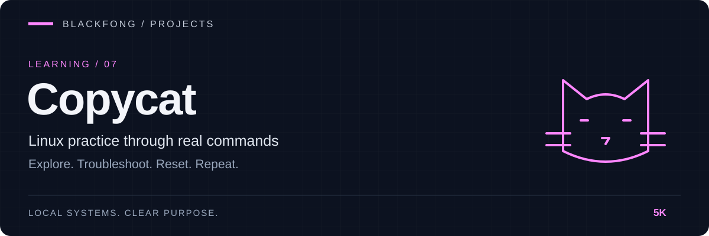

<div align="center">



**A real Linux command sandbox. SSH in, break things, reset in one command.**

[](https://github.com/5K-bit/Copycat/actions/workflows/ci.yml)


[](LICENSE)

</div>

[Quick start](#quick-start) · [Labs](#labs) · [Troubleshooting mode](#troubleshooting-mode)

---

## Overview

Copycat is a Docker-based Linux and cybersecurity training environment. You SSH into a **real Kali Linux shell**; nothing is simulated. `rm` deletes, `chmod 000` locks you out, and `ssh` opens a genuine connection to a second machine on an isolated network. When you've made a mess, one command rebuilds a clean environment.

It's built for learning the way sysadmins and security engineers actually learn: by running real commands against real systems, safely, and repeating until it's muscle memory.

## Features

- **Real shell, real consequences.** Kali Linux with `bash`, `sudo`, `apt`, `man`, `cron`, `rsyslog` and a seeded home directory to explore.
- **Two-machine network.** `copycat-kali` plus an Alpine `copycat-target` running sshd and HTTP, reachable only from the Kali box. Practice `ssh`, `scp`, `rsync`, `curl` and recon against a live host.
- **40 guided labs.** Each has steps, a self-check and a challenge, with progress tracked in-shell (`copycat-labs`, `copycat-done NN`).
- **Automated grading.** 12 labs break something real and score your fix out of 100 with `copycat-check`. Best scores are saved to a local SQLite database and shown in `copycat-labs`.
- **Troubleshooting mode.** `copycat-trouble` breaks something real (SSH, permissions, a full disk, DNS, a service, CPU, ownership, a backup) and grades how you diagnose and fix it.
- **Safe by construction.** No volumes, no host mounts, no Docker socket, not privileged, SSH bound to loopback only. See [Safety model](#safety-model).
- **One-command lifecycle.** `copycat-start`, `copycat-stop`, `copycat-reset`, plus a `copycat-selftest` that verifies the whole environment.
- **Cross-platform.** PowerShell launchers for Windows, shell scripts for Linux, macOS and WSL.

## Architecture

```
Host (Windows / Linux / macOS) → Docker
 └─ copycat (compose project)
     ├─ copycat-kali    SSH :2222 (127.0.0.1 only) · bash · sudo · apt · man · cron · rsyslog
     └─ copycat-target  Alpine · sshd · HTTP :80 · user "student" · reachable only from copycat-kali
```

More detail in [docs/ARCHITECTURE.md](docs/ARCHITECTURE.md).

## Quick start

**Requirements:** Docker (Desktop on Windows/macOS) and Git.

```powershell
copycat-start             # build + start (first build downloads Kali; a few minutes)
copycat-ssh               # same as: ssh copycat@127.0.0.1 -p 2222   (password: copycat)
copycat-stop              # pause; your changes are kept
copycat-reset             # blow it all away and rebuild from the image
copycat-reset -Rebuild    # same, but rebuild images from scratch too
copycat-selftest          # verify the environment (needs only Docker + Git Bash/WSL)
```

The launchers live in `bin\` and call the scripts in `scripts\`, which you can also run directly (`.\scripts\copycat-start.ps1`; Linux, WSL and macOS use the `.sh` versions).

`copycat-stop` keeps whatever you did inside the lab; only `copycat-reset` wipes it. After `copycat-reset -Rebuild`, ssh may warn that the host key changed: run `ssh-keygen -R "[127.0.0.1]:2222"` once.

| Machine | Login | Notes |
|---|---|---|
| `copycat-kali` | `copycat` / `copycat` | non-root, in `sudo` (password required). Others: `alex`, `sam`, `jordan` / `password` |
| `copycat-target` | `student` / `student` | from Kali: `ssh student@copycat-target`, `curl http://copycat-target` |

Inside the sandbox: `copycat-help`, `copycat-labs` (progress list), `copycat-done NN` (mark a lab finished), `copycat-setup NN` / `copycat-check NN` (graded labs), `copycat-trouble` (troubleshooting mode), `copysay` (a tip from the cat).

> These credentials are deliberately simple training defaults for a sandbox bound to `127.0.0.1`. Don't reuse them anywhere real.

## Labs

Exercises are plain READMEs in `~/labs/NN-name/`, about 14 hours in total. Labs 01-20 cover the command-line fundamentals; labs 21-40 go deeper into system administration and troubleshooting.

| # | Lab | # | Lab |
|---|---|---|---|
| 01 | Core commands | 11 | File transfer |
| 02 | Navigation | 12 | Archives and compression |
| 03 | Files | 13 | Disk usage |
| 04 | Searching | 14 | Logs |
| 05 | Text processing | 15 | Package management (APT) |
| 06 | Permissions | 16 | Shell and shortcuts |
| 07 | Users and groups | 17 | Pipes and redirection |
| 08 | Processes | 18 | Scheduling with cron |
| 09 | Networking | 19 | Shell scripting |
| 10 | SSH | 20 | Text editors |

**Labs 21-40.** Labs marked ✔ are graded: run `copycat-setup NN` to break something, fix it, then `copycat-check NN`. Lab 06 (Permissions) is graded too.

| # | Lab | Time | Graded |
|---|---|---|---|
| 21 | The Linux filesystem hierarchy | ~20 min | |
| 22 | Environment variables and `$PATH` | ~20 min | |
| 23 | Symbolic and hard links | ~20 min | |
| 24 | Advanced file permissions | ~35 min | ✔ |
| 25 | The Linux boot process | ~25 min | |
| 26 | System services | ~25 min | |
| 27 | DNS troubleshooting | ~25 min | |
| 28 | Storage: filesystems, partitions, mounts and swap | ~30 min | |
| 29 | SSH authentication | ~30 min | ✔ |
| 30 | System performance | ~25 min | |
| 31 | User administration | ~30 min | ✔ |
| 32 | Service troubleshooting | ~30 min | |
| 33 | Firewall administration | ~35 min | ✔ |
| 34 | Backup and recovery | ~30 min | ✔ |
| 35 | Scheduled automation with cron | ~30 min | ✔ |
| 36 | Package troubleshooting | ~30 min | ✔ |
| 37 | Git fundamentals | ~35 min | ✔ |
| 38 | Bash automation | ~40 min | ✔ |
| 39 | Linux hardening | ~35 min | ✔ |
| 40 | System recovery | ~40 min | ✔ |

## Troubleshooting mode

```
copycat-trouble list                  # the scenarios
copycat-trouble start [NAME|random]   # break something and show the symptom
copycat-trouble hint                  # a nudge (run again for a bigger one)
copycat-trouble check                 # grade your fix (PASS/FAIL, score saved)
copycat-trouble reveal                # explain the cause and the fix
copycat-trouble reset                 # put everything back
```

Scenarios: `broken-ssh`, `missing-permissions`, `full-disk`, `broken-dns`, `failed-service`, `cpu-overload`, `wrong-ownership`, `failed-backup`. Scores go to the same SQLite database as `copycat-check`.

## Safety model

No volumes or host mounts, no Docker socket, not privileged, no host network, default capabilities, pid/memory/CPU limits, SSH bound to loopback only. Reset touches only the `copycat` compose project, so your other containers are never affected. To report a security issue, see [SECURITY.md](SECURITY.md).

## Honest limits

Copycat doesn't fake Linux, so some things are out of scope by design:

- No systemd, so `hostnamectl`/`systemctl` aren't meaningful. `service ssh|cron|rsyslog status` is real.
- `lspci`, `lsusb`, `dmidecode`, `mount`, `iptables`, `ufw` aren't available (hardware / extra capabilities). The firewall lab (33) uses a small simulator, `fwsim`, because containers run without `NET_ADMIN`; a real firewall belongs in a later isolated `copycat-system` container.
- The package lab (36) installs from an offline repository built at image build time, so it works without the Internet.
- `pacman`, `rpm`, `dnf` need their own distros (planned `copycat-arch`, `copycat-rpm`).
- The container is online (apt/wget to the Internet work). An isolated mode is a later phase: Docker can't publish SSH to the host from a network-less container, so it needs a small gateway design.
- Host SSH keys are baked in at build, so resets don't trigger "host key changed" warnings; `-Rebuild` will. `copycat-ssh` skips host-key checks (the port is loopback-only), so it never warns.

## Roadmap

- [ ] `copycat-system` container for hardware and firewall tooling
- [ ] `copycat-arch` and `copycat-rpm` for other package managers
- [ ] Isolated (offline) mode via a small gateway
- [ ] Security-focused labs (recon, web, privilege escalation) against `copycat-target`
- [ ] Real firewall exercises once an isolated container with `NET_ADMIN` exists

## Repository layout

| Path | Purpose |
|---|---|
| `compose.yaml` | the two-machine environment |
| `kali/` | Dockerfile, entrypoint, banner, helper commands |
| `target/` | Alpine target: Dockerfile, `www/`, `home/` |
| `seed/generate.sh` | builds the training file tree at image build time |
| `labs/` | exercise READMEs, copied into the image |
| `grading/`, `scenarios/` | check and setup scripts for graded labs and troubleshooting scenarios (root-owned in the image, not in `~/labs`) |
| `tests/` | test-only solutions used by `copycat-selftest` |
| `scripts/`, `bin/` | lifecycle scripts and Windows launchers |

## Verification

- `copycat-selftest` checks the running environment end to end (services, networking, graded labs, troubleshooting scenarios, safety settings).
- CI runs shellcheck and `compose config`, builds the images, then starts the containers, waits for the healthchecks and runs the selftest on every pull request and push to `main`. On failure it uploads container logs and health state as an artifact, and it always cleans up.
- Startup readiness evidence, including the reproduction method and what was and was not observed: [docs/READINESS-EVIDENCE.md](docs/READINESS-EVIDENCE.md).

## Ownership

**Problem.** CI proved the images build, not that the lab works. A broken service, a bad seed or a startup ordering problem would have passed CI.

**Evidence.** CI ran `docker compose build` only. I suspected a startup race, so I wrote [`scripts/copycat-readiness-repro.sh`](scripts/copycat-readiness-repro.sh) and ran the selftest right after `compose up` 20 times. All 20 passed, so no race was observed; the confirmed gap was that CI never ran the selftest ([evidence](docs/READINESS-EVIDENCE.md)).

**Decision.** Run the existing selftest in CI instead of writing a second, smaller check. Add real healthchecks and wait on them, so CI does not depend on timing. I did not call the problem a race, because it was not reproduced.

**Implementation.** The `selftest` job in [`.github/workflows/ci.yml`](.github/workflows/ci.yml), healthchecks in `kali/Dockerfile` and `target/Dockerfile`, and `depends_on: condition: service_healthy` in `compose.yaml`.

**Verification.** The reproduction script, 20 passing runs before and after the change, and the CI job itself.

**Remaining limits.** The 20-run measurement is from one Windows and Docker Desktop host, not a GitHub runner. A race that needs a slower machine would not show up there. The selftest takes about 2.5 minutes on that host, which CI now pays on every run.

## Development practice

AI tools assist with implementation, debugging, tests, and documentation.
Louis Boddie owns project direction and acceptance decisions; linked tests and release evidence document what has been verified.

## Contributing

Issues and pull requests are welcome. See [CONTRIBUTING.md](CONTRIBUTING.md).

## License

[MIT](LICENSE) © 5K-bit
